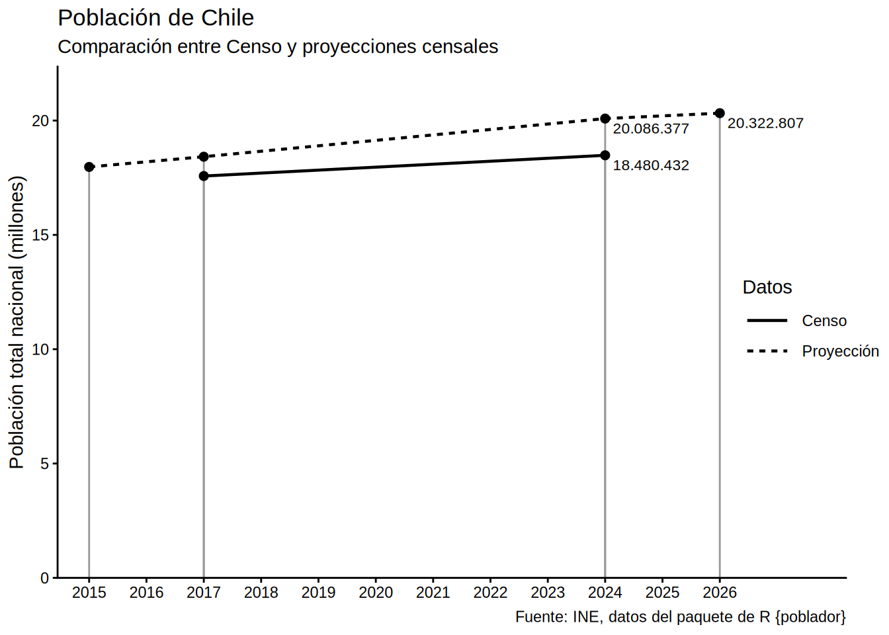

# Gráfico de población nacional de Chile

``` r

library(poblador)
library(dplyr)
```

El paquete incluye tablas de datos de los últimos censos de Chile:

``` r

library(poblador)

censo_poblacion_2024
```

    # A tibble: 346 × 8
       codigo_region nombre_region codigo_provincia nombre_provincia codigo_comuna
               <dbl> <chr>                    <dbl> <chr>                    <dbl>
     1             1 Tarapacá                    11 Iquique                   1101
     2             1 Tarapacá                    11 Iquique                   1107
     3             1 Tarapacá                    14 Tamarugal                 1401
     4             1 Tarapacá                    14 Tamarugal                 1405
     5             1 Tarapacá                    14 Tamarugal                 1404
     6             1 Tarapacá                    14 Tamarugal                 1402
     7             1 Tarapacá                    14 Tamarugal                 1403
     8             2 Antofagasta                 22 El Loa                    2201
     9             2 Antofagasta                 21 Antofagasta               2102
    10             2 Antofagasta                 22 El Loa                    2203
    # ℹ 336 more rows
    # ℹ 3 more variables: nombre_comuna <chr>, año <dbl>, poblacion <int>

``` r

censo_poblacion_2017
```

    # A tibble: 346 × 8
       codigo_region nombre_region codigo_provincia nombre_provincia codigo_comuna
               <dbl> <chr>                    <dbl> <chr>                    <dbl>
     1             1 Tarapacá                    11 Iquique                   1101
     2             1 Tarapacá                    11 Iquique                   1107
     3             1 Tarapacá                    14 Tamarugal                 1401
     4             1 Tarapacá                    14 Tamarugal                 1402
     5             1 Tarapacá                    14 Tamarugal                 1403
     6             1 Tarapacá                    14 Tamarugal                 1404
     7             1 Tarapacá                    14 Tamarugal                 1405
     8             2 Antofagasta                 21 Antofagasta               2101
     9             2 Antofagasta                 21 Antofagasta               2102
    10             2 Antofagasta                 21 Antofagasta               2103
    # ℹ 336 more rows
    # ℹ 3 more variables: nombre_comuna <chr>, año <dbl>, poblacion <dbl>

También incluye las últimas proyecciones de población disponibles a
nivel de comuna, que son en base al Censo 2017, y que pueden filtrarse
por año:

``` r

library(dplyr)

censo_poblacion_proyeccion |> 
  filter(año == 2030)
```

    # A tibble: 346 × 8
       codigo_region nombre_region codigo_provincia nombre_provincia codigo_comuna
               <dbl> <chr>                    <dbl> <chr>                    <dbl>
     1             1 Tarapacá                    11 Iquique                   1101
     2             1 Tarapacá                    11 Iquique                   1107
     3             1 Tarapacá                    14 Tamarugal                 1401
     4             1 Tarapacá                    14 Tamarugal                 1402
     5             1 Tarapacá                    14 Tamarugal                 1403
     6             1 Tarapacá                    14 Tamarugal                 1404
     7             1 Tarapacá                    14 Tamarugal                 1405
     8             2 Antofagasta                 21 Antofagasta               2101
     9             2 Antofagasta                 21 Antofagasta               2102
    10             2 Antofagasta                 21 Antofagasta               2103
    # ℹ 336 more rows
    # ℹ 3 more variables: nombre_comuna <chr>, año <dbl>, poblacion <dbl>

Procesamos los datos para obtener tres tablas con poblaciones de
distintos años y mediciones:

``` r

pob_2017 <- poblador::censo_poblacion_2017 |> 
  mutate(tipo = "Censo")

pob_2024 <- poblador::censo_poblacion_2024 |> 
  mutate(tipo = "Censo")

año_actual <- as.integer(format(Sys.Date(), "%Y"))

pob_2026 <- poblador::censo_poblacion_proyeccion |> 
  filter(año %in% c(2015, 2017, 2024, año_actual)) |> 
  mutate(tipo = "Proyección")
```

Luego las unimos:

``` r

datos <- bind_rows(
  pob_2017,
  pob_2024,
  pob_2026
)
```

Ahora obtenemos una suma de las poblaciones para llegar a la población
nacional:

``` r

datos_anual <- datos |> 
  group_by(año, tipo) |> 
  summarize(poblacion = sum(poblacion))
```

    `summarise()` has regrouped the output.
    ℹ Summaries were computed grouped by año and tipo.
    ℹ Output is grouped by año.
    ℹ Use `summarise(.groups = "drop_last")` to silence this message.
    ℹ Use `summarise(.by = c(año, tipo))` for per-operation grouping
      (`?dplyr::dplyr_by`) instead.

Finalmente generamos un gráfico de los cambios de población en Chile
según las últimas mediciones censales y la proyección del año en curso:

``` r

library(ggplot2)
library(scales)

datos_anual |> 
  ggplot() +
  aes(año, poblacion,
      linetype = tipo) +
  geom_segment(
    aes(xend = año, yend = 0),
    linetype = "solid", linewidth = 0.5,
    color = "#999999") +
  geom_line(linewidth = .8) +
  geom_point(size = 2) +
  geom_text(
    data = ~filter(.x, año %in% c(2024, 2026)),
    aes(label = label_comma(big.mark = ".")(poblacion)),
    hjust = -0.1, vjust = 1.5, size = 3
  ) +
  scale_y_continuous(
    labels = label_comma(scale = 1e-6, big.mark = "."),
    expand = expansion(c(0, 0.1))
  ) +
  scale_x_continuous(
    breaks = seq(min(datos_anual$año), max(datos_anual$año)),
    expand = expansion(c(.05, .2))
  ) +
  labs(title = "Población de Chile",
       subtitle = "Comparación entre Censo y proyecciones censales",
       caption = "Fuente: INE, datos del paquete de R {poblador}",
       linetype = "Datos",
       y = "Población total nacional (millones)", x = NULL) +
  theme_classic(base_family = "Arial") +
  theme(legend.key.width = unit(1, "cm"),
        legend.margin = margin(l = -70))
```


