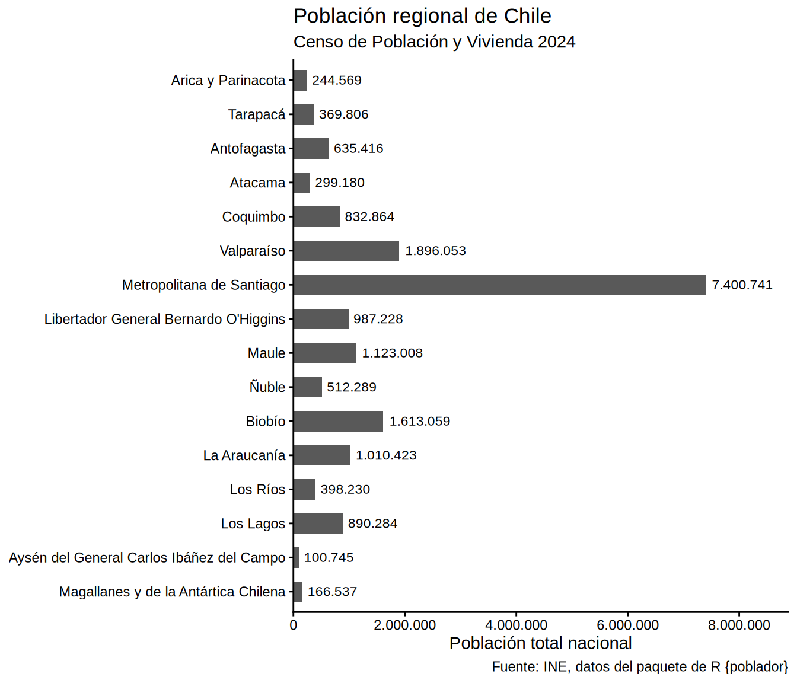

# Gráfico de población regional de Chile

``` r

library(poblador)
library(dplyr)
```

El paquete incluye tablas de datos de los últimos censos de Chile, que
puedes revisar ejecutando
[`poblador::catalogo()`](https://bastianolea.github.io/poblador/reference/catalogo.md).
Por ejemplo:

``` r

censo_poblacion_2024 |> 
  select(nombre_comuna, año, poblacion) |> 
  head()
```

    # A tibble: 6 × 3
      nombre_comuna   año poblacion
      <chr>         <dbl>     <int>
    1 Iquique        2024    199587
    2 Alto Hospicio  2024    142086
    3 Pozo Almonte   2024     16878
    4 Pica           2024      6272
    5 Huara          2024      2858
    6 Camiña         2024      1335

Para calcular la población regional de Chile, realizamos una [suma
agrupada con
`summarize()`](https://bastianolea.rbind.io/blog/r_introduccion/dplyr_summarize/):

``` r

pob_regional <- poblador::censo_poblacion_2024 |> 
  group_by(nombre_region, codigo_region) |> 
  summarize(poblacion = sum(poblacion)) |> 
  ungroup() |> 
  territorial::ordenar_regiones(invertir = TRUE)
```

    `summarise()` has regrouped the output.
    ℹ Summaries were computed grouped by nombre_region and codigo_region.
    ℹ Output is grouped by nombre_region.
    ℹ Use `summarise(.groups = "drop_last")` to silence this message.
    ℹ Use `summarise(.by = c(nombre_region, codigo_region))` for per-operation
      grouping (`?dplyr::dplyr_by`) instead.

Luego generamos un gráfico de barras:

``` r

library(ggplot2)
library(scales)

pob_regional |> 
  ggplot() +
  aes(x = poblacion, y = nombre_region) +
  geom_col(width = .6) +
  geom_text(
    aes(label = label_comma(big.mark = ".")(poblacion)),
    hjust = -0.1, size = 3
  ) +
  scale_x_continuous(
    labels = label_comma(big.mark = "."),
    expand = expansion(c(0, 0.2))
  ) +
  labs(title = "Población regional de Chile",
       subtitle = "Censo de Población y Vivienda 2024",
       caption = "Fuente: INE, datos del paquete de R {poblador}",
       x = "Población total nacional", y = NULL) +
  theme_classic(base_family = "Arial")
```


